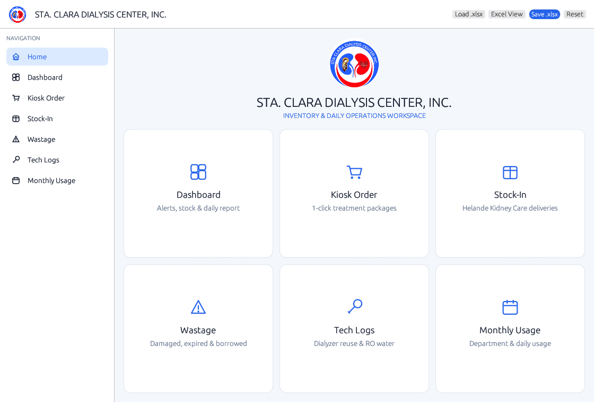
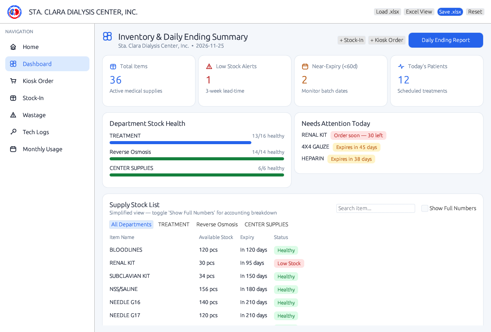
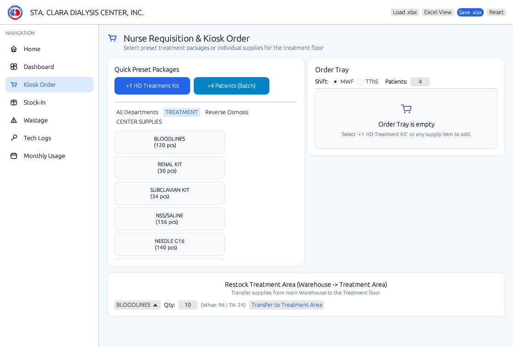
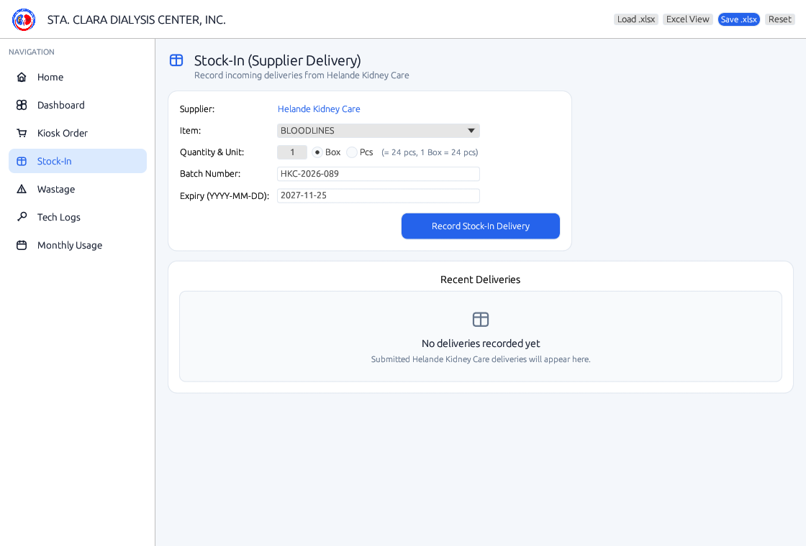
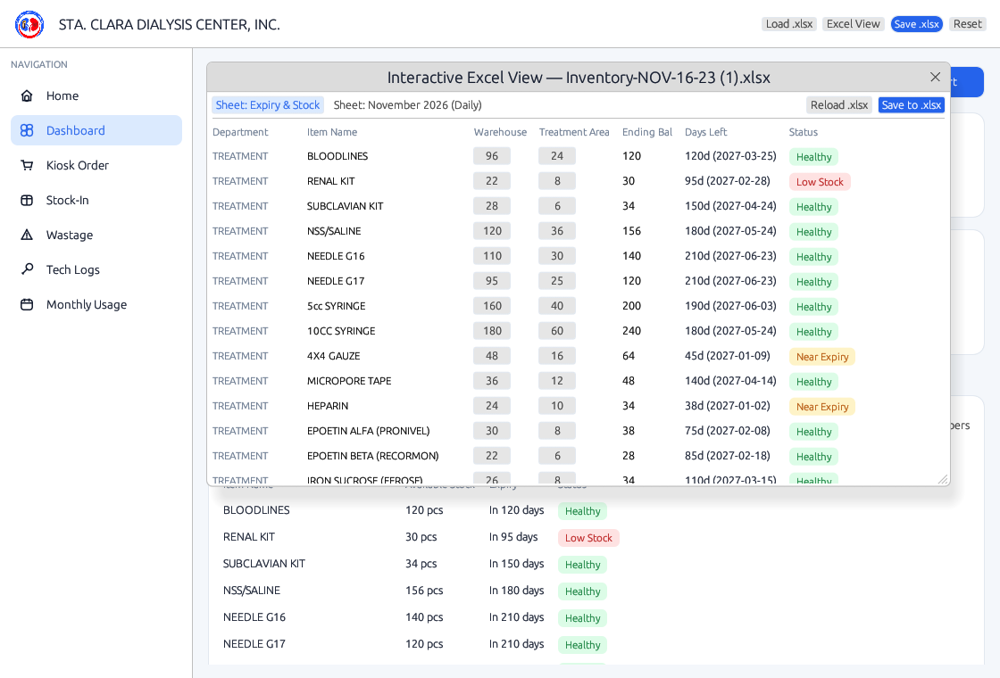

<p align="center">
  
</p>

<p align="center">
  
  &nbsp;&nbsp;&nbsp;
  
</p>

A fast, offline-ready desktop application built for **Sta. Clara Dialysis Center, Inc.** to help nurses, technicians, and clinic owners track medical supplies, daily patient usage, expiration dates, and end-of-day balances—all in one place.

> [!NOTE]
> **Works 100% Offline:** No internet connection or cloud account is required. All clinic data stays safely on your computer and syncs directly with your existing Excel workbook.

---

## How the Daily Workflow Works

<p align="center">
  
</p>

## What You Can Do

- **Home Screen:** Clean, easy-to-read cards for every clinic task with a friendly mascot that guides you as you hover.
- **Dashboard & Safety Alerts:**
  - Automatically checks **Warehouse + Treatment Area** stock levels.
  - Flags any supply with **fewer than 150 pieces** as **Dangerous (<150)** and highlights items expiring within **60 days**.
  - Lets you filter alerts by **All**, **Critical Stock**, or **Expiring Soon**, and add low items straight to your order tray.
- **Kiosk Order (Nurse Requisition):**
  - Tap **+1 HD Treatment Kit** or a batch button to add standard dialysis supplies in one click.
  - Switch to **Warehouse -> TA Transfer** anytime to restock the treatment floor from the main warehouse.
- **Stock-In (Supplier Deliveries):** Record incoming deliveries from **Helande Kidney Care** by Box or Piece with automatic conversion, batch numbers, and expiration dates.
- **Wastage & Adjustments:** Log damaged, expired, or borrowed supplies with a short reason note.
- **Technician Logs:** Track patient dialyzer reuse cycles (`0/12`) and record daily RO Water quality checks (Hardness, Chlorine, Peroxide).
- **Excel Sync (`.xlsx`):**
  - Click **Excel View** to inspect or edit your spreadsheet right inside the app.
  - Choose **Overwrite Original** (with automatic `.bak` backup) or **Timestamped Copy** when saving.

> [!TIP]
> Every important action—such as confirming an order, recording a delivery, or saving to Excel—shows a confirmation pop-up first to prevent accidental changes.

## Getting Started

Double-click **`run.bat`** in the project folder, or run it from your terminal:

```powershell
.\run.bat
```

If you have the Windows installer (`StaClaraDialysis-Setup.exe`), simply double-click it and follow the **Next → Next → Install** wizard.

---

## Screenshots (v1 — Design as of Nov 25, 2026)

| Home Workspace | Dashboard & Safety Alerts |
| :---: | :---: |
|  |  |

| Kiosk Order | Stock-In |
| :---: | :---: |
|  |  |

<p align="center">
  
</p>
