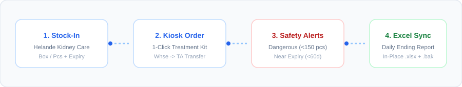

<p align="center">
  
</p>

<p align="center">
  
  &nbsp;&nbsp;&nbsp;
  
</p>

A local-first, GPU-accelerated **pure Rust** (`eframe` / `egui` + `wgpu`) desktop inventory & daily ending balance application built for **Sta. Clara Dialysis Center, Inc.**

---

## End-to-End Clinic Workflow

<p align="center">
  
</p>

## Key Features
- **Home Workspace & Interactive Mascot:** Glassmorphic launcher cards with an interactive mascot that peeks and points at hovered modules.
- **Dashboard & Safety Alerts:** Tracks `Ending Balance = Warehouse + Treatment Area`, flags **`Dangerous (<150)`** stock and **`< 60 days`** near-expiry batches, and organizes alerts into **All**, **Critical Stock**, and **Expiring Soon** tabs.
- **Kiosk Order (Nurse Requisition):** 1-click Hemodialysis Treatment Packages, dynamic batch presets, medical vector icons, and **Warehouse → TA Transfer** mode.
- **Stock-In & Wastage:** Helande Kidney Care deliveries with Box/Pcs auto-conversion, plus Damaged / Expired / Borrowed deductions.
- **Technician Logs:** Dialyzer Reuse cycle counter (`0/12`) and Daily RO Water Quality checks.
- **In-Place Excel Sync (`.xlsx`):** Interactive **Excel View** modal, `Earliest Expiry` column, `Overwrite Original` (with `.bak`), and `Timestamped Copy` modes.
- **Safety Confirmation Modals & UI Debugger (`F12`):** Confirmation pop-ups on every state-changing action, plus `F12` hover inspector.

## Quick Start

```powershell
# Run the desktop app
.\run.bat
# or
cargo run

# Run all unit & headless UI tests
cargo test

# Build standalone release executable
cargo build --release
```
